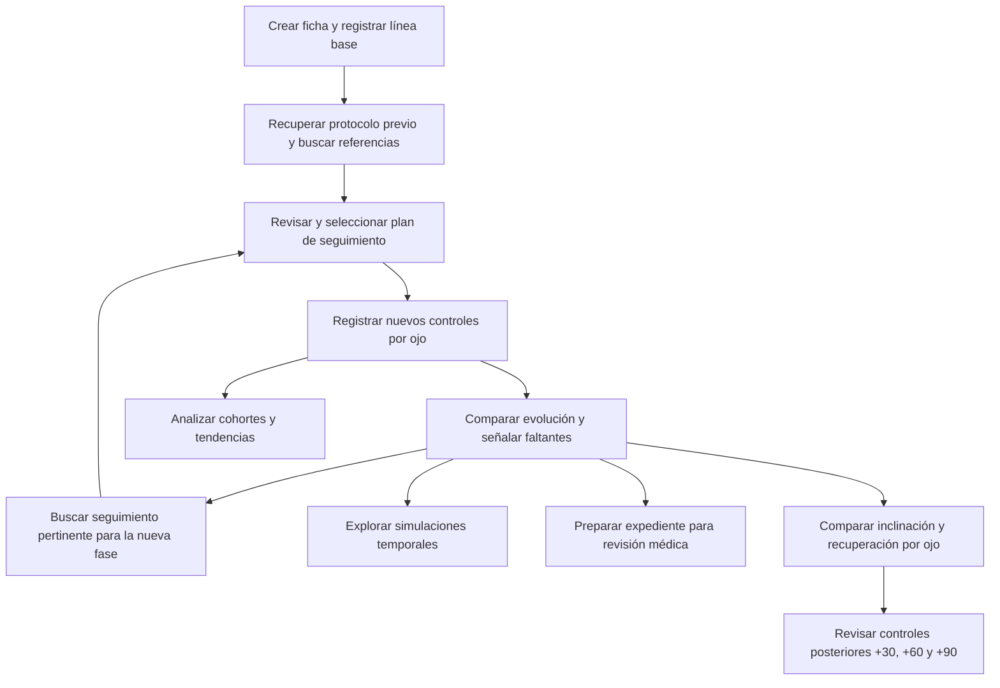

# 🚀 SPACE VISION — SANS MONITOR
### NASA Space Apps Challenge 2026 · Querétaro, México
**Revisión Longitudinal Trazable de Expedientes Oculares, Seguimiento de Protocolos y Simulación Biomecánica del Síndrome SANS**

[](https://sans-visualrehabcenter-spaceappschallenge.nexusdigitaldb.com)
[](https://github.com/JGTI/SANS)
[](docs/SANS_MONITOR_SPEC.md)

[](https://www.php.net/)
[](https://laravel.com/)
[](https://fastapi.tiangolo.com/)
[-22c55e?style=flat&logo=php&logoColor=white)]()
[]()
[](https://www.spaceappschallenge.org/)

---

> 🌐 **URL de Producción / Demostración en Vivo:**  
> **[https://sans-visualrehabcenter-spaceappschallenge.nexusdigitaldb.com](https://sans-visualrehabcenter-spaceappschallenge.nexusdigitaldb.com)**
>
> 📄 **Especificación Definitiva de Software (Documento Canónico):**  
> **[`docs/SANS_MONITOR_SPEC.md`](docs/SANS_MONITOR_SPEC.md)**
>
> 📦 **Repositorio Oficial:**  
> **[https://github.com/JGTI/SANS](https://github.com/JGTI/SANS)**

---

## 🌌 1. Objetivo y Alcance de SANS Monitor

**SANS Monitor (SPACE VISION) reúne las revisiones oculares de una persona en una sola línea de tiempo.**  
Convierte un expediente ocular en una revisión trazable: permite recuperar qué protocolo y estudios se usaron antes, encontrar referencias o seguimientos pertinentes, mostrar qué ha cambiado por ojo (**OD / OS**) antes, durante un vuelo o exposición inclinada y en controles posteriores (**+30, +60 y +90 días**), y estudiar si existen señales útiles para anticipar cambios futuros.

La aplicación ayuda al equipo médico a distinguir tres situaciones operativas:
1. **«Listo para revisión» (Estable):** Hay datos comparables y el ojo se mantiene estable dentro del criterio del protocolo.
2. **«Priorizar revisión» (En progresión):** Hay mediciones comparables que muestran empeoramiento (ej. $\Delta\text{TRT} \ge 20\ \mu\text{m}$ señal temprana o $\ge 55\ \mu\text{m}$ marcador primario).
3. **«Faltan datos» (Seguimiento insuficiente):** Faltan línea base, escaneos previos o controles recientes para decidir.

> **Alcance ético y preventivo:** La aplicación ayuda al equipo médico a preparar la vigilancia y la evaluación del candidato, **sin emitir un veredicto automático de aptitud** («apto / no apto»), ni diagnosticar SANS, ni prescribir contramedidas. El foco permanece en el ojo; los antecedentes neurológicos, metabólicos, cardiovasculares, ambientales y conductuales se muestran en una capa plegable de contexto como información de apoyo para investigación.

### Entregas del Proyecto
- **P0:** Demo funcional con fichas pseudónimas y escenarios ficticios reproducibles (estable, empeora, sin escaneos previos / sin control reciente, asimetría interocular).
- **P1:** Entorno de investigación con datos autorizados, procedencia (`observed_at` vs. `available_at`), curación de protocolos y revisión humana (`ClinicianDecision`).
- **P2:** Pronóstico experimental validado en cohorte independiente (separado de observaciones y simulación; muestra «No estimable» fuera de su alcance validado).

---

## 🧭 2. Flujo General de Revisión Longitudinal



---

## 🛰️ 3. Sistemas, Módulos y Rutas Operativas

| Módulo | Ruta Web | Descripción y Capacidades |
|---|---|---|
| **Mission Control Dashboard** | `/admin` | Centro de operaciones con estado de revisión por expediente («Listo para revisión», «Faltan datos», «Priorizar revisión»), telemetría orbital y curvas longitudinales Chart.js. |
| **Expedientes de Salud Visual** | `/admin/crew/{code}` | Ficha longitudinal por ojo (OD/OS), protocolo previo, referencias de seguimiento, comparativa contra línea base y controles +30, +60 y +90 días. |
| **Vision Lab Oftalmológico** | `/admin/vision-lab` | Registro determinista de refracción ($SE = \text{SPH} + \text{CYL}/2$), agudeza Snellen $\to$ LogMAR, vectores de Thibos ($M, J_0, J_{45}, B$), PIO y exportador CSV. |
| **Consola ZEISS Cirrus™ HD-OCT** | `/admin/oct-analysis` | Estación clínica Macular Cube 512x128 con matriz de 9 paneles, mapas ILM-RPE, fondo LSO, B-Scans H/V, rejillas ETDRS y asimetría interocular ($\Delta\text{OD-OS}$). |
| **Astronaut Digital Twin (3D + Dual)** | `/admin/digital-twin` | Gemelo Digital 3D WebGL (Three.js) con corte sagital, fondo de ojo y corte OCT sincronizados, y vista dual simultánea (`?mode=dual`). |
| **Simulador Temporal SANS** | `/admin/mission-simulator` | Reproducción histórica y simulación ilustrativa (hitos 10 → 15 → 30 y rangos 0–30, 0–90, 0–150 días) con casos estable, empeora, sin escaneos y asimétrico. |
| **NASA Data Observatory & Catálogo** | `/admin/nasa-data` | Catálogo curado de protocolos y conector resiliente con **NASA OSDR**, **NASA NTRS**, **NASA DONKI** y **APOD** con caché offline. |
| **AI Command Center & Model Lab** | `/admin/ai-command` · `/admin/model-lab` | Monitoreo en vivo del motor científico Python FastAPI (`:8001`) y benchmark supervisado/no supervisado (Random Forest, GBM, OLS, Isolation Forest). |
| **Explainability (XAI) & Data Quality** | `/admin/explainability` · `/admin/data-quality` | Atribución de características SHAP con intervalos de incertidumbre y auditoría de completitud, duplicados y límites fisiológicos. |
| **Model Registry & Linaje** | `/admin/model-registry` | Versionado auditable de protocolos de análisis y modelos (`VALIDATED`, `CANDIDATE`, `EXPERIMENTAL`). |
| **Demo Theater & Reporte Oficial** | `/admin/demo-theater` · `/admin/demo-theater/report/{code}` | Recorrido guiado de 5 pasos para evaluación del hackatón y expediente imprimible en formato médico aeroespacial (`@media print`). |
| **Gestión de API Keys & Arquitectura** | `/admin/api-keys` | Administración de credenciales con prueba de ping en vivo, sincronización `.env` y diagrama interactivo SVG de 5 capas. |
| **Consola de Mantenimiento** | `/admin/maintenance` | Ejecución segura de comandos Artisan y control del motor científico Python. |

---

## 📚 4. Documentación Oficial del Proyecto

| Documento | Propósito |
|---|---|
| **[`docs/SANS_MONITOR_SPEC.md`](docs/SANS_MONITOR_SPEC.md)** | **Especificación canónica de software (`RF-01`–`RF-37`, `RNF-01`–`RNF-06`, contrato de datos y pruebas `AT-01`–`AT-19`).** |
| **[`docs/IMPLEMENTATION_PHASES.md`](docs/IMPLEMENTATION_PHASES.md)** | **Esquema maestro de las 6 fases de implementación (P0 $\to$ P1 $\to$ P2), arquitectura modular y casos de prueba.** |
| [`docs/PROJECT_VISION.md`](docs/PROJECT_VISION.md) | Visión científica, fases P0/P1/P2, indicadores oculares, los 5 dominios de contexto y referencias bibliográficas. |
| [`docs/ARCHITECTURE.md`](docs/ARCHITECTURE.md) | Arquitectura híbrida de 5 capas (Frontend Blade/Three.js, Laravel 11, Enlace Bearer, Python FastAPI `:8001` y conectores NASA). |
| [`docs/DECISIONS.md`](docs/DECISIONS.md) | Registro de Decisiones de Arquitectura (`ADR-001` a `ADR-005`). |
| [`docs/DEVELOPMENT_STATE.md`](docs/DEVELOPMENT_STATE.md) | Estado actual de módulos implementados y baseline de pruebas automatizadas. |
| [`docs/TASK_BACKLOG.md`](docs/TASK_BACKLOG.md) | Backlog maestro por épicas (Épicas 1 a 14). |
| [`docs/HACKATHON_SUBMISSION.md`](docs/HACKATHON_SUBMISSION.md) | Ficha ejecutiva oficial para el jurado del NASA Space Apps Challenge 2026. |

---

## 📖 5. Referencias Científicas Precargadas

- **[NASA OCHMO, guía técnica sobre el riesgo SANS](https://www.nasa.gov/wp-content/uploads/2024/02/ochmo-mtb-001-sans.pdf):** Referencia técnica, no una autorización de uso clínico automático para la app.
- **[Consenso de especialistas sobre diagnóstico y manejo de SANS (2026)](https://doi.org/10.1038/s41433-026-04651-6):** Referencia para separar hallazgos, umbrales y calendarios de investigación de los hitos de la demo.
- **[Macias et al. (2020), cambios oculares estructurales y recuperación](https://doi.org/10.1001/jamaophthalmol.2020.0673):** Diferencias entre mediciones en órbita y controles antes/después.
- **[Carter et al. (2025), estudio de progresión del edema del disco óptico](https://doi.org/10.1001/jamaophthalmol.2025.4635):** Referencia para los días 30 y 150, no un predictor de aptitud.
- **[NASA Life Sciences Portal (NLSP)](https://www.nasa.gov/hrp/nlsp/):** Punto de partida para consultar o solicitar datos humanos autorizados.
- **[Laurie et al. (2019), comparación ocular entre vuelo espacial y análogo terrestre de reposo inclinado](https://doi.org/10.1001/jamaophthalmol.2019.5261):** Fundamento para separar datos orbitales y de exposición inclinada ($-6^\circ$).
- **[NASA Human Research Program, plan de investigación de riesgos 2026](https://www.nasa.gov/wp-content/uploads/2026/08/hrp-rap-for-web-62026-hhc.pdf):** Fundamenta tratar los factores fisiológicos y ambientales como preguntas abiertas y no como causas demostradas.

---

## 🔑 6. Credenciales Maestras de Demostración

La pantalla de inicio de sesión (`/login`) incluye botones de autorrelleno con un solo clic:

> **Contraseña universal para todas las cuentas de prueba:** `SpaceVision2026!`

| Rol en SANS Monitor | Rol del Sistema | Correo Electrónico | Responsabilidad |
|---|---|---|---|
| **Presentador / Evaluador de Demo** | `super-admin` | `admin@spacevision.nasa` | Crear/editar fichas ficticias, reproducir escenarios, control total y consola Artisan. |
| **Responsable de Datos / Curador** | `admin` | `operator@spacevision.nasa` | Importar mediciones, auditar calidad/procedencia y curar el catálogo de protocolos. |
| **Especialista Médico Autorizado** | `flight-surgeon` | `surgeon@spacevision.nasa` | Revisar el expediente, documentar seguimiento pertinente y registrar dictamen humano fuera del motor de reglas. |
| **Investigador / Analista** | `researcher` | `researcher@spacevision.nasa` | Explorar cohortes, comparar inclinación/recuperación y ejecutar comparaciones de modelos. |
| **Tripulante Simulado** | `astronaut` | `astronaut@spacevision.nasa` | Consulta de expediente visual longitudinal. |

---

## 💻 7. Puesta en Marcha y Verificación de Pruebas

```bash
# 1. Verificar o iniciar el microservicio científico Python (FastAPI en :8001)
php artisan scientific:engine status
php artisan scientific:engine start

# 2. Ejecutar la suite de pruebas científicas en Python (21 tests en Pytest)
php artisan scientific:engine test

# 3. Ejecutar la suite completa de pruebas en Laravel (67 tests / 287 aserciones en PHPUnit)
php artisan test
```

---

**SPACE VISION — SANS Monitor · NASA Space Apps Challenge 2026 (Querétaro, México)**
