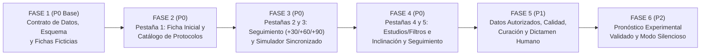

# 🗺️ SANS MONITOR (SPACE VISION) — ESQUEMA MAESTRO DE FASES DE IMPLEMENTACIÓN

> **Documento Operativo de Ejecución**  
> **Especificación Rectora:** [`docs/SANS_MONITOR_SPEC.md`](SANS_MONITOR_SPEC.md)  
> **Principio de Progresión:** **P0** (Demo funcional con fichas y escenarios ficticios) $\to$ **P1** (Entorno de investigación con datos autorizados y revisión humana) $\to$ **P2** (Pronóstico experimental validado). *Una fase no presupone el éxito de la siguiente y ninguna rompe el baseline de pruebas existente (67 PHPUnit / 21 Pytest).*

---

## 📊 Visión General de la Hoja de Ruta (6 Fases de Ingeniería)

---

## 🏗️ Mapeo Modular de Arquitectura (Sección 6 de la Especificación)

Para mantener el 100% de compatibilidad con la infraestructura existente en producción (Laravel 11 + Python FastAPI en `:8001`), la separación sugerida en la especificación se estructura así:

| Capa de la Especificación | Ubicación en Laravel 11 (`app/` y `resources/`) | Ubicación en Python Scientific Engine (`scientific_engine/app/`) |
|---|---|---|
| **`domain/`** (tipos de medición, líneas base, estados, reglas temporales) | `app/Models/SansMonitor/*`, `app/Services/SansMonitor/TimelineRuleEngine.php` | `scientific_engine/app/domain/` |
| **`catalog/`** (fuentes, versiones, búsqueda y explicación de coincidencias) | `app/Services/SansMonitor/ProtocolCatalogService.php`, `storage/app/sans_catalog/protocols.json` | `scientific_engine/app/catalog/` |
| **`simulation/`** (escenarios, puntos sintéticos y fotogramas esquemáticos) | `app/Services/SansMonitor/ScenarioEngine.php` | `scientific_engine/app/simulation/` |
| **`analytics/`** (cohortes, denominadores, ventanas e intervalos) | `app/Services/SansMonitor/CohortAnalyticsService.php` | `scientific_engine/app/analytics/` |
| **`ui/`** (5 pestañas unificadas, filtros, capas SVG/3D/OCT y panel de contexto) | `app/Http/Controllers/Admin/SansMonitorController.php`, `resources/views/admin/sans-monitor/*` | Endpoints REST `/api/v1/sans-monitor/*` |
| **`tests/`** (pruebas unitarias y las 19 pruebas de aceptación `AT-01` a `AT-19`) | `tests/Feature/SansMonitorAcceptanceTest.php` | `scientific_engine/tests/test_sans_monitor.py` |

---

## 🚀 FASE 1 (P0 — Paso 1): Contrato Mínimo de Datos, Esquema y Semillas de Escenarios Ficticios

**Objetivo:** Construir el cimiento de datos exacto de la Sección 4 de `SANS_MONITOR_SPEC.md` sin alterar las tablas legadas, garantizando que los valores faltantes sean `NULL` con estado explícito (nunca ceros) y que ningún punto sintético se guarde como observación clínica.

### 1.1 Entidades y Tablas Nuevas / Extendidas
1. **`sans_cases` y `sans_missions` (`Case` y `Mission`):**
   - `case_id` (pseudónimo/ficticio, ej. `CASE-SANS-01`), `mission_id`, `source_type` (`FICTICIO_DEMO`, `ANALOGO_TERRESTRE`, `ORBITAL_AUTORIZADO`), `mission_phase` (`PRE_VUELO`, `EN_VUELO`, `POSVUELO`, `PRE_EXPOSICION`, `EN_EXPOSICION`, `POSEXPOSICION`), `planned_duration_days`, `previous_flights`, `reason_for_review`, `baseline_status` (`COMPLETA`, `PARCIAL`, `SIN_LINEA_BASE`, `NO_APLICA`, `DESCONOCIDO`).
2. **`sans_metric_observations` (`Observation`):**
   - `observation_id`, `case_id`, `mission_id` (nullable), `eye` (`OD`, `OS`), `observed_at`, `available_at`, `mission_day`, `available_day`, `metric_code` (`AXIAL_LENGTH`, `POSTERIOR_FLATTENING`, `SPHERICAL_EQ`, `CHOROID_THICKNESS`, `CHORIORETINAL_FOLD`, `PERIPAPILLARY_TRT`, `RNFL`, `FRISEN_GRADE`, `IOP`), `value` (nullable), `categorical_value` (nullable), `unit`, `region`, `modality`, `quality`, `status` (`MEDIDO`, `SIN_MEDICION`, `NO_EVALUABLE`, `PENDIENTE_DISPONIBILIDAD`), `baseline_observation_id` (nullable), `source_type`.
3. **`sans_protocol_versions` y `sans_case_protocols` (`ProtocolVersion` y `CaseProtocol`):**
   - Catálogo con las **7 referencias oficiales** precargadas (NASA OCHMO, Consenso 2026, Macias 2020, Carter 2025, NLSP, Laurie 2019, NASA HRP 2026), diferenciando `PROTOCOLO_OPERATIVO`, `CONSENSO`, `ARTICULO_INVESTIGACION` y `ESCENARIO_DEMO`, con `supersedes_version_id` verificado.
4. **`sans_scenario_points` (`ScenarioPoint`):**
   - `scenario_id`, `mission_day`, `eye`, `metric_code`, `scenario_value`, `unit`, `visual_layer`, `is_interpolated` (separado de `sans_metric_observations`).
5. **`sans_assessments` y `sans_clinician_decisions` (`Assessment` y `ClinicianDecision`):**
   - `assessment_state` (`LISTO_PARA_REVISION`, `FALTAN_DATOS`, `PRIORIZAR_REVISION`), `reason_codes`, `input_ids`, `rule_or_model_version`, `as_of_day`.
   - `sans_clinician_decisions` en tabla independiente exclusiva para firma médica autorizada (por defecto muestra «Aptitud no evaluada»).
6. **`sans_exposure_sessions`, `sans_exposure_segments` y `sans_exposure_observation_links`:**
   - Soporte para inclinación (ej. $-6^\circ$ cabeza abajo) y tramos múltiples con ángulos distintos sin promediar, usando `end_at` como día `+0` de recuperación.
7. **`sans_followup_plans`, `sans_followup_visits` y `sans_followup_actions`:**
   - Hitos objetivo **+30, +60 y +90 días** con estados `PENDIENTE`, `REALIZADO`, `VENCIDO_SIN_DATO`, `NO_EVALUABLE`.
8. **`sans_context_records` (`ContextRecord`):**
   - Los 5 dominios (`NEUROLOGICO`, `METABOLICO`, `CARDIOVASCULAR`, `AMBIENTAL`, `CONDUCTUAL`) con soporte para «No medido» / «No disponible».

### 1.2 Casos Ficticios Precargados (Seeder P0 — `RF-22`, `RF-33`)
- **Caso 1 (`CASE-STABLE-01`):** Caso estable con línea base completa, dos controles en vuelo comparables y seguimiento +30/+60/+90.
- **Caso 2 (`CASE-PROG-02`):** Caso asimétrico en progresión: OD pasa de $\Delta\text{TRT} +8\ \mu\text{m}$ (día 10) a $+14\ \mu\text{m}$ (día 15) y $+26\ \mu\text{m}$ (día 30, superando el disparador ilustrativo de $+20\ \mu\text{m}$), mientras OS permanece estable; incluye resultado del día 15 con `available_day = 20` (`AT-04`) y falta de medición en `+60` aunque existan `+30` y `+90` (`AT-16`).
- **Caso 3A (`CASE-NOSCAN-03A`):** Sin escaneos previos ni OCT basal, pero con PIO registrada (`AT-01`, `AT-07`, `AT-17`).
- **Caso 3B (`CASE-NORECENT-03B`):** Con historial previo y línea base, pero con control reciente faltante (`AT-07`).
- **Caso 4 (`CASE-TILT-04`):** Participante con exposición previa en análogo terrestre de $-6^\circ$ (dos tramos de inclinación y valores TRT $280 \to 304 \to 284\ \mu\text{m}$ a +30 días, es decir $+24\ \mu\text{m}$ y $+4\ \mu\text{m}$) y además una misión orbital independiente (`AT-10`, `AT-11`, `AT-14`, `AT-19`).

**Criterio de cierre de Fase 1:** Migraciones, modelos, seeder y pruebas unitarias del contrato de datos en verde.

---

## 📋 FASE 2 (P0 — Paso 2): Pestaña 1 — «Ficha y Protocolos» (`RF-01` a `RF-09`)

**Objetivo:** Implementar la apertura y edición de fichas pseudónimas, captura de antecedentes por ojo y el buscador explicable del catálogo curado de protocolos.

### Entregables Técnicos
1. **Formulario de Ficha y Alimentación (`RF-01`, `RF-02`, `RF-03` P0):**
   - Selectores explícitos para distinguir `Desconocido` de `No aplica`.
   - Creación de ficha sin exigir OCT previa; señalización automática de qué falta para comparar contra la línea base.
   - Importador CSV con validador de duplicados y comparabilidad de modalidad/región (`AT-09`).
2. **Motor de Catálogo y Búsqueda Separada (`RF-05`, `RF-06`, `RF-07`):**
   - Bloque 1: **Protocolo previamente aplicado** a la ficha.
   - Bloque 2: **Referencias pertinentes para seguimiento posterior** (ordenadas por aplicabilidad documentada y luego fecha dentro del mismo tipo de documento).
   - Bloque 3 (Filtro independiente): **Versiones más recientes verificadas** (`supersedes_version_id`).
   - Explicación de cada coincidencia con `matched_criteria`, `missing_criteria` y etiqueta explícita «Búsqueda en catálogo curado». Si no hay coincidencias verificadas, muestra «No se encontró un protocolo aplicable en el catálogo».

**Pruebas de Aceptación Cubiertas:** `AT-01`, `AT-02`, `AT-09`.

---

## 👁️ FASE 3 (P0 — Paso 3): Pestañas 2 y 3 — «Seguimiento del Ojo (+30/+60/+90)» y «Simulador Temporal» (`RF-10` a `RF-13`, `RF-18` a `RF-22`, `RF-31` a `RF-36`)

**Objetivo:** Unificar el estado de selección (persona, ojo OD/OS/bilateral, visita y día) entre el seguimiento longitudinal, el simulador de 3 vistas y las tarjetas posvuelo/posexposición +30, +60 y +90 días.

### Entregables Técnicos
1. **Resumen Operativo sin Dictamen de Aptitud (`RF-10`, `RF-11`, `RF-12` P0):**
   - Salidas estrictas por expediente y ojo: **«Listo para revisión»**, **«Faltan datos»**, **«Priorizar revisión»**, manteniendo separadas la completitud de la ficha y las señales oculares (`AT-05`).
   - Etiqueta fija **«Aptitud no evaluada»** (salvo dictamen firmado por especialista autorizado) y ausencia total de porcentajes individuales o etiquetas «apto/no apto» (`AT-08`).
2. **Seguimiento Cronológico por Fase y Tarjetas +30, +60 y +90 (`RF-31` a `RF-34`):**
   - Fases **Antes**, **Durante** (días 10, 15, 30), **Fin (+0)** y **Después (+30, +60, +90 días)** etiquetando «Día 30 de vuelo» vs «+30 días tras aterrizar» como hitos distintos (`AT-15`).
   - Si falta `+60` pero existen `+30` y `+90`, muestra **«Sin medición»** sin interpolar (`AT-16`).
3. **Simulador Temporal Sincronizado de 3 Vistas (`RF-18` a `RF-21`):**
   - Botones de paso **10 → 15 → 30** y selectores de rango **0–30**, **0–90** y **0–150** días.
   - Tres vistas esquemáticas sincronizadas: **Sagital del globo**, **Fondo de ojo con disco óptico** y **Corte de capas tipo OCT**, mostrando $\Delta SE$ como cambio de graduación numérica y no como deformación deducida del dibujo.
   - Modo **Reproducción histórica** (oculta el resultado del día 15 hasta el día 20 según `available_day`, `AT-04`; muestra «Sin medición en este día») vs. **Simulación ilustrativa** (marca puntos interpolados y muestra «Fuera del rango» tras el último punto definido, `AT-03`).
4. **Panel Plegable «Contexto del Caso» (`RF-35`, `RF-36`):**
   - 5 dominios (Neurológico, Metabólico, Cardiovascular, Ambiental, Conductual) que al abrirse o cerrarse no alteran el estado ocular ni las acciones sugeridas (`AT-18`).

**Pruebas de Aceptación Cubiertas:** `AT-03`, `AT-04`, `AT-05`, `AT-08`, `AT-15`, `AT-16`, `AT-17`, `AT-18`.

---

## 📐 FASE 4 (P0 — Paso 4 y 5): Pestañas 4 y 5 — «Estudios y Tendencias» e «Inclinación y Seguimiento» (`RF-14` a `RF-15`, `RF-26` a `RF-29`)

**Objetivo:** Incorporar el tablero multicriterio de cohortes y la quinta pestaña comparativa para exposiciones inclinadas (como $-6^\circ$ HDT) y su recuperación pos-exposición.

### Entregables Técnicos
1. **Pestaña 4 — «Estudios y Tendencias» con 4 Controles de Filtro (`RF-14`, `RF-15`):**
   - Filtros combinables: **Conjunto de datos** (`ficticio`, `análogo terrestre`, `orbital autorizado`), **Evolución observada** (`estable`, `en progresión`, `sin datos suficientes`), **Cobertura** (`sin línea base`, `sin escaneos previos`, `sin control reciente`, `con controles comparables`) y **Motor de evaluación** (`regla de demo`, `referencia publicada`, `modelo experimental`).
   - Diferenciación exacta entre «sin escaneos previos» y «sin control reciente» sin clasificar ninguno como estable (`AT-06`, `AT-07`).
2. **Pestaña 5 — «Inclinación y Seguimiento» (`RF-26` a `RF-29`):**
   - Selector de participante, exposición, ojo y medición con conmutador de eje temporal (**Día de misión** vs. **Día desde fin de exposición**, deshabilitado si el fin es desconocido, `AT-12`).
   - Visualización de tramos múltiples de inclinación sin promediar (`AT-14`).
   - Comparador de dos visitas del mismo ojo y procedimiento compatible (bloqueando comparaciones incompatibles con explicación explícita, `AT-13`).
   - Cálculo exacto del ejemplo de referencia: $280\ \mu\text{m}$ (antes) $\to 304\ \mu\text{m}$ (primer control, $+24\ \mu\text{m}$) $\to 284\ \mu\text{m}$ (+30 días, $+4\ \mu\text{m}$), mostrando «Seguimiento insuficiente» si falta el control tardío y exigiendo tolerancia documentada antes de etiquetar «Retorno al rango basal» (`AT-10`, `AT-11`).
   - Separación estricta entre la línea base del análogo de $-6^\circ$ y la línea base de la misión orbital de la misma persona (`AT-19`).

**Pruebas de Aceptación Cubiertas:** `AT-06`, `AT-07`, `AT-10`, `AT-11`, `AT-12`, `AT-13`, `AT-14`, `AT-19`.

---

## 🔐 FASE 5 (P1): Entorno de Investigación Autorizado, Curación y Auditoría Clínica

**Objetivo:** Habilitar el flujo completo de investigación con separación de permisos (Spatie RBAC), importación auditada y revisión médica firmada.

### Entregables Técnicos
- **Importación Autorizada y Procedencia (`RF-03` P1, `RF-04`):** Vista previa por fila, validación de unidades/fechas, preservación del registro original ante correcciones.
- **Curación de Protocolos y Adopción Auditada (`RF-08`, `RF-09`):** Alta, archivo y versión de protocolos; registro de adopción o cambio de seguimiento firmado por el revisor autorizado con fecha y motivo.
- **Dictamen Humano del Especialista (`RF-11`):** Formulario exclusivo para rol `flight-surgeon` que guarda en `sans_clinician_decisions` (fecha, autor, alcance y protocolo utilizado).
- **Analítica de Cohortes y Exportación (`RF-14` P1, `RF-16`, `RF-17`, `RF-23`, `RF-24`, `RF-30`):** Denominadores, censura en la última visita válida sin imputar negativos posteriores, comparación día 30 vs día 90 vs día 150 separando entrenamiento/prueba por astronauta, y agrupación por ángulo/duración en estudios de inclinación.

---

## 🧪 FASE 6 (P2): Pronóstico Experimental Validado

**Objetivo:** Evaluar modelos predictivos de forma rigurosa y separada de la simulación y de las observaciones clínicas.

### Entregables Técnicos
- **Separación de Pronóstico Experimental (`RF-12` P2, `RF-25`, `RF-37`):**
  - Comparación de modelo base (solo variables oculares, con edema de disco óptico como desenlace principal) frente a modelo secundario con factores de contexto preespecificados disponibles al momento del pronóstico.
  - Reporte de calibración, sensibilidad a tasa fija de falsas alertas, casos omitidos, anticipación y cobertura.
  - Emisión de «No estimable» cuando falten entradas o el caso esté fuera del alcance validado.

---

## ✅ Orden Inmediato de Arranque (Paso a Paso)

1. **Ejecutar Fase 1:** Crear migraciones, modelos, motor de reglas de dominio y semillero con los casos ficticios canónicos (`CASE-STABLE-01`, `CASE-PROG-02`, `CASE-NOSCAN-03A`, `CASE-NORECENT-03B`, `CASE-TILT-04`) y el catálogo de las 7 referencias oficiales.
2. **Ejecutar Fases 2, 3 y 4 (Workspace Unificado SANS Monitor de 5 Pestañas en `/admin/sans-monitor`):** Construir las 5 pestañas interactivas interconectadas que satisfacen los requisitos P0 y las 19 pruebas de aceptación (`AT-01` a `AT-19`).
3. **Ejecutar Suite Completa de Aceptación (`SansMonitorAcceptanceTest`):** Verificar automáticamente las 19 pruebas `AT-01` a `AT-19` junto con las 67 pruebas existentes de Laravel y las 21 de Python.
