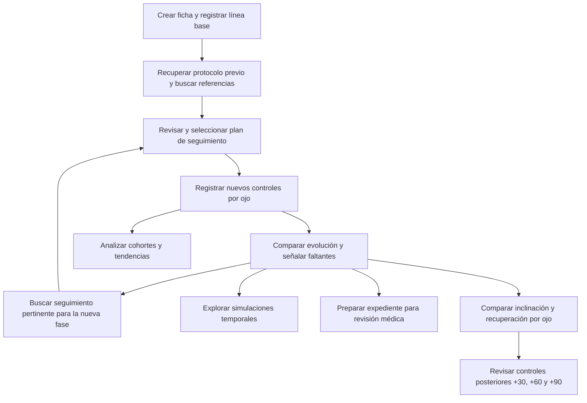

# SANS Monitor — Especificación de software para desarrollo

> **Documento canónico de requerimientos del proyecto SPACE VISION / SANS Monitor.**
> Versión: 1.0 · Fecha de adopción: 14 de noviembre de 2026 · Repositorio: https://github.com/JGTI/SANS
>
> Este documento **prevalece** sobre cualquier otra descripción funcional del repositorio cuando exista conflicto
> (README, `docs/PROJECT_VISION.md`, `docs/SPACE_VISION/*`, prompts maestros previos). Las decisiones de
> implementación derivadas se registran en [`DECISIONS.md`](DECISIONS.md) y el avance en
> [`TASK_BACKLOG.md`](TASK_BACKLOG.md) y [`DEVELOPMENT_STATE.md`](DEVELOPMENT_STATE.md).

**Objetivo.** Convertir un expediente ocular en una revisión trazable: recuperar qué protocolo y estudios se usaron antes, encontrar referencias o seguimientos pertinentes, mostrar qué ha cambiado por ojo y estudiar si hay señales útiles para anticipar cambios futuros. La aplicación ayuda al equipo médico a preparar la vigilancia y la evaluación del candidato, sin emitir un veredicto automático de aptitud.

**Entregas.** **P0** es una demo funcional con fichas y escenarios ficticios. **P1** es un entorno de investigación con datos autorizados y revisión humana. **P2** es pronóstico experimental validado. Una fase no presupone el éxito de la siguiente.

## Contexto general para presentar el proyecto

**SANS Monitor reúne las revisiones oculares de una persona en una sola línea de tiempo.** El equipo puede ver cómo estaba cada ojo antes de un vuelo o exposición, qué cambió durante y qué seguía diferente en controles posteriores. La app ayuda a distinguir tres situaciones: hay datos y el ojo se mantiene estable, hay mediciones que muestran empeoramiento, o faltan estudios para decidir. Su propósito es facilitar la revisión, no determinar quién es apto para volar.

El proyecto mantendrá el foco en el ojo. Los antecedentes neurológicos, metabólicos, cardiovasculares, ambientales y conductuales se muestran como información de apoyo que puede orientar preguntas de investigación. En el hackatón se verá el flujo con casos ficticios. Con datos reales autorizados se investigará si el seguimiento permite detectar cambios antes y si esos cambios se resuelven o siguen presentes en los controles disponibles.

## 1. Flujo general



El ciclo se repite cuando llega un examen nuevo o cambia la fase de misión. Una coincidencia de búsqueda nunca sustituye por sí sola el protocolo que el equipo había seleccionado.

## 2. Usuarios y permisos

| Rol | Responsabilidad |
| --- | --- |
| Presentador / evaluador de demo | Crear o editar fichas ficticias, reproducir escenarios y navegar el tablero. |
| Responsable de datos | Importar mediciones autorizadas, resolver problemas de calidad y conservar su procedencia. |
| Curador de protocolos | Agregar fuentes, documentar criterios de aplicabilidad, verificar versiones y publicar entradas revisadas en el catálogo interno. |
| Investigador / analista | Explorar cohortes y ejecutar comparaciones de modelos dentro del entorno autorizado. |
| Especialista médico autorizado | Revisar el expediente, documentar qué seguimiento considera pertinente y decidir la aptitud fuera del motor de reglas. |

La demo no requiere cuentas. P1 separa por permisos la carga de datos, la curación de fuentes y la revisión clínica.

## 3. Backlog funcional

### A. Formulario inicial y alimentación de datos

| ID | Prioridad | Requisito y criterio de aceptación |
| --- | --- | --- |
| RF-01 | P0 | Crear una ficha con ID pseudónimo o ficticio, fase de misión, duración prevista, historial de vuelos y motivo de revisión. El formulario indica los datos obligatorios y deja distinguir «desconocido» de «no aplica». Puede abrirse una ficha aunque todavía no exista una OCT. |
| RF-02 | P0 | Agregar antecedentes oculares relevantes, exámenes previos, modalidad, fecha, ojo y resultado. Guardar una referencia al protocolo aplicado anteriormente si se conoce. Aceptar entradas incompletas y señalar qué falta para comparar contra la línea base. |
| RF-03 | P0/P1 | Guardar la línea base y los controles por ojo y misión. En P0, por formulario y carga de datos ficticios CSV. En P1, importar archivos autorizados con vista previa, detección de duplicados, validación de unidades y fechas, y reporte por fila. Una corrección no borra el dato original. |
| RF-04 | P1 | Registrar procedencia y calidad de cada medición. Guardar el día real de toma y el día en que el resultado estuvo disponible. Conservar modalidades, regiones y equipos distintos sin tratarlos automáticamente como equivalentes. |

**Datos auxiliares de búsqueda.** Fase y duración de misión, modalidad disponible, fecha del último control, hallazgos conocidos, objetivo de revisión y protocolo previo, si se conoce. Son distintos de las variables de investigación. Un dato no se convierte en predictor solo porque exista en el formulario. En P0 no se solicitan nombres reales, fechas de nacimiento exactas ni identificadores clínicos.

### B. Catálogo y búsqueda de protocolos

| ID | Prioridad | Requisito y criterio de aceptación |
| --- | --- | --- |
| RF-05 | P0 | Cargar un catálogo curado. Cada ficha incluye título, organización, URL o DOI, tipo de documento, versión o fecha de publicación, fases, población, criterios de aplicación y relación con otras versiones. Distinguir protocolo operativo, consenso, artículo de investigación y escenario de demo. |
| RF-06 | P0 | Recuperar el protocolo **previamente aplicado** a la ficha, si está registrado. En una lista separada, buscar entradas pertinentes al **seguimiento posterior** según fase, duración, hallazgo y modalidad. Buscar versiones más recientes del mismo documento es un filtro aparte y solo se vinculan como versiones cuando la relación está verificada. |
| RF-07 | P0 | Explicar cada coincidencia con criterios cumplidos, requisitos pendientes y versión. Ordenar primero por aplicabilidad documentada y luego por fecha dentro del mismo tipo de documento. Si no hay coincidencias verificadas, mostrar «No se encontró un protocolo aplicable en el catálogo». Un artículo reciente no se presenta como protocolo operativo. |
| RF-08 | P1 | Permitir curar, actualizar y archivar entradas sin cambiar el historial de cada ficha. Al incorporar un control nuevo, el sistema puede volver a buscar y mostrar diferencias. Solo el revisor autorizado adopta otro protocolo o registra un seguimiento. Auditar la decisión y su motivo. |
| RF-09 | P1 opcional | Incorporar búsqueda en fuentes públicas autorizadas usando solo términos genéricos, sin datos personales ni resultados del expediente. Guardar cada hallazgo como pendiente hasta verificar autoridad, versión y aplicabilidad. Mientras no exista esta integración, la UI indica «Búsqueda en catálogo curado», no «búsqueda exhaustiva». |

**Ejemplo de búsqueda.** Fase en vuelo + control OCT incompleto + objetivo de seguimiento ocular. El sistema devuelve el protocolo anterior si está asociado, las referencias pertinentes y los requisitos que no se pudieron verificar. Si no hay línea base, no intenta calcular una progresión ni inventa un protocolo.

### C. Revisión de candidatos y afectaciones futuras

| ID | Prioridad | Requisito y criterio de aceptación |
| --- | --- | --- |
| RF-10 | P0 | Mostrar un resumen del expediente con tres salidas operativas: «Listo para revisión», «Faltan datos» y «Priorizar revisión». Incluir hallazgo o requisito faltante, ojo, fecha y fuente. «Listo para revisión» significa que el expediente reúne los campos exigidos para revisar, no que el candidato sea apto. Mantener por separado la completitud de la ficha y las señales oculares. |
| RF-11 | P1 | Si se requiere documentar aptitud, permitir registrar **solo el dictamen emitido por el especialista autorizado**. Conservar fecha, autor, alcance de la evaluación y criterio o protocolo utilizado. Si no existe dictamen, mostrar «Aptitud no evaluada». El motor de reglas, los filtros y el simulador no pueden escribir ni modificar el dictamen. |
| RF-12 | P0/P2 | En P0, mostrar «Qué podría ocurrir en este escenario» con datos sintéticos. En P2, separar «Pronóstico experimental» de observaciones y simulación. Solo emitirlo para un resultado, población y horizonte evaluados, con incertidumbre y versión del modelo. Si faltan entradas o el caso está fuera del alcance validado, mostrar «No estimable». No presentar probabilidades sintéticas como riesgo individual. |

**Alcance preventivo.** La app ayuda a detectar faltantes y a priorizar la revisión o el próximo control. No certifica aptitud, diagnostica SANS, prescribe contramedidas ni afirma que una alerta evite una afectación.

### D. Dashboard de expedientes, estudios y tendencias

| ID | Prioridad | Requisito y criterio de aceptación |
| --- | --- | --- |
| RF-13 | P0 | Vista de expediente con ficha, protocolo anterior, referencias de seguimiento, estado por ojo, últimos controles y fecha de disponibilidad. Permitir seleccionar ojo izquierdo, derecho o comparación bilateral. |
| RF-14 | P0/P1 | Vista de estudio con filtros por fase, rango de días, misión o cohorte, ojo, hallazgo, versión de protocolo y procedencia del dato. En P0, mostrar cifras de demo etiquetadas. En P1, mostrar recuentos y denominadores, seguimiento disponible e incertidumbre cuando se estime incidencia. Distinguir frecuencia observada, recurrencia y recuperación. |
| RF-15 | P0 | Separar controles de filtro: **conjunto de datos** (ficticio, análogo terrestre, orbital autorizado), **evolución observada** (estable, en progresión, sin datos suficientes), **cobertura** (sin línea base, sin escaneos previos, sin control reciente, con controles comparables) y **motor de evaluación** (regla de demo, referencia publicada, modelo experimental cuando exista). Los filtros pueden combinarse. Mostrar recuento y estado vacío sin errores. |
| RF-16 | P1 | Exportar resultados agregados junto con los filtros, ventana, denominador, definición del evento y versiones de datos y protocolo. No incluir información identificable ni mezclar simulaciones con métricas orbitales por defecto. |
| RF-17 | P1 | Estimar cuándo aparece un hallazgo como un intervalo entre el último control válido bajo el umbral y el primero que lo alcanza. Si no se observa el evento, cerrar el seguimiento en la última visita válida sin imputar como negativo el periodo posterior. En un análisis por astronauta, contar el primer ojo afectado. |

**Clasificación de trayectorias.** «Estable» y «En progresión» son etiquetas por ojo, hallazgo y ventana, basadas en mediciones suficientes y una regla explícita. No son diagnósticos. Los filtros diferencian «no tiene ningún escaneo anterior» de «sí tiene historial, pero falta un control reciente». Un aviso anterior sigue visible en el historial aunque la evaluación actual sea insuficiente.

**Regla reproducible de la demo.** Usar un mínimo de dos controles en vuelo comparables en la ventana para etiquetar una trayectoria, además de la línea base cuando el indicador sea un cambio respecto al pre-vuelo. Los umbrales de demo y la fecha esperada del siguiente control vienen del escenario y se muestran en la explicación. Ejemplo ficticio de regresión visual: el ojo derecho pasa de ΔTRT +8 µm (día 10) a +14 µm (día 15) y +26 µm (día 30), mientras el izquierdo permanece estable. Con un disparador ilustrativo de +20 µm fijado para ese escenario, el aviso aparece al día 30. Un aviso por hallazgo y la bandera por datos faltantes pueden coexistir. Ningún umbral ilustrativo debe activarse en expedientes reales.

### E. Simulador temporal del ojo

| ID | Prioridad | Requisito y criterio de aceptación |
| --- | --- | --- |
| RF-18 | P0 | Reproducir una misión ficticia con control de tiempo para ir y volver por los días **10 → 15 → 30**. Permitir rangos predefinidos de **0–30**, **0–90** y **0–150** días si el escenario cubre ese periodo. Agregar un tramo posvuelo solo si se conoce la fecha de regreso y hay datos o escenarios para ese tramo. Estos días son hitos de la demo, no un calendario recomendado por NASA. |
| RF-19 | P0 | Incluir tres vistas esquemáticas **sagital del globo**, **fondo de ojo con disco óptico** y **corte de capas tipo OCT**. Mostrar en la vista pertinente el eje anteroposterior, el contorno posterior, la cabeza del nervio óptico, el engrosamiento retiniano o coroideo y los pliegues cuando corresponda. Mostrar el desplazamiento hipermetrópico como cambio de graduación, no como una deformación deducida del dibujo. |
| RF-20 | P0 | Sincronizar vista, ojo, día y gráfica. Ofrecer activación por capas y comparación pre-vuelo vs. día seleccionado. Si no hay línea base o una capa no se observó, indicarlo en vez de dibujarla como normal. Diferenciar señal numérica, esquema explicativo y fotografía o imagen clínica si se llegara a integrar en otra fase. |
| RF-21 | P0 | Separar **reproducción histórica** de **simulación**. En reproducción, solo usar resultados ya disponibles en el día seleccionado. Entre visitas mostrar «Sin medición en este día» y, si corresponde, el último valor con su fecha. En simulación, etiquetar cada fotograma como ilustrativo y marcar cualquier interpolación como tal. Después del último punto definido, mostrar «Fuera del rango» sin extrapolar automáticamente. |
| RF-22 | P0 | Precargar, como mínimo, caso estable, caso que empeora y caso sin escaneos previos. Incluir dentro del escenario sin escaneo la variante con control reciente faltante para no confundirla con ausencia total de historial. Usar al menos un escenario asimétrico para probar que un ojo puede cambiar mientras el otro no. |

### F. Investigación y validación

| ID | Prioridad | Requisito y criterio de aceptación |
| --- | --- | --- |
| RF-23 | P1 | Versionar el protocolo de análisis, los resultados principales y secundarios, las reglas de calidad y las cohortes. Permitir al especialista confirmar o corregir etiquetas sin sobrescribir el historial. |
| RF-24 | P1 | Comparar como referencia el dato del día 30 con el resultado cerca del día 150. Para probar un pronóstico actualizado al día 90, contrastar en los mismos ojos y horizonte tres entradas: solo día 30, solo día 90 y trayectoria más hallazgos coroideos disponibles. Separar entrenamiento y prueba por astronauta, incluyendo ambos ojos y vuelos. |
| RF-25 | P2 | Evaluar con una cohorte independiente y reportar calibración, sensibilidad a una tasa predefinida de falsas alertas, casos omitidos, anticipación y cobertura. Después, si procede, ejecutar alertas en modo silencioso sin modificar la atención. Afirmar mitigación requeriría un estudio posterior de impacto. |

### G. Pantalla comparativa «Inclinación y seguimiento»

**Pregunta de investigación.** En la misma persona y el mismo ojo, ¿qué mediciones cambian entre la línea base y el primer control posterior a una exposición inclinada, y cuáles siguen distintas de la línea base en controles posteriores? Si hay un grupo comparador, ¿difiere esa evolución entre grupos?

| ID | Prioridad | Requisito y criterio de aceptación |
| --- | --- | --- |
| RF-26 | P0/P1 | Registrar una exposición separada de la misión: ID, origen, ángulo en grados, orientación (cabeza abajo, cabeza arriba u horizontal), referencia angular a la horizontal, inicio, fin y versión del protocolo aplicable. Derivar la duración si existe un inicio y un fin válidos. Los campos desconocidos quedan explícitos. Si el ángulo cambió durante la exposición, registrar tramos con sus ángulos y tiempos sin sustituirlos por un promedio oculto. P0 usa exposiciones ficticias. P1 importa observaciones autorizadas. |
| RF-27 | P0 | Añadir una quinta pestaña, **Inclinación y seguimiento**, con selector de participante, exposición, ojo y medición. Reutilizar la línea de tiempo, los esquemas del ojo y las observaciones existentes. Permitir elegir dos visitas para ver valor inicial, valor de comparación, diferencia con signo, unidad y día de toma. Mostrar el ángulo y la duración como datos de exposición, no como un valor deducido del estado del ojo. |
| RF-28 | P0/P1 | Distinguir cuatro tipos de visita: **antes**, **durante** si existe, **primer control posexposición** y **seguimiento**. Mostrar cuánto tiempo transcurrió desde el fin de la exposición en cada control posterior. Permitir seleccionar ventanas de seguimiento definidas por el protocolo, sin confundir el día de misión con el día transcurrido desde el fin de la exposición. Cuando el fin es desconocido, no estimar la duración ni los días posexposición. |
| RF-29 | P0/P1 | Mostrar por hallazgo **cambio observado**, **retorno al rango basal**, **cambio aún observado en el último control** o **seguimiento insuficiente**, usando criterios documentados para cada medición. Para declarar retorno o persistencia, exigir un control tardío válido y una tolerancia o criterio del protocolo. Si falta ese criterio, mostrar solo valores y diferencia, sin clasificar. Si no hay línea base comparable, no calcular el cambio. Un pliegue se compara como ausencia, presencia o cambio de región, no como una resta numérica. |
| RF-30 | P1 | En «Estudios y tendencias», permitir agrupar por ángulo registrado, duración, protocolo y ventana de seguimiento. Mostrar cuántas personas y ojos tienen pares comparables, cuántos carecen de seguimiento y hasta qué día se observaron. Si existen participantes comparables con otra exposición o sin ella, ofrecer comparación entre grupos. Sin comparador, etiquetar los resultados como diferencias descriptivas antes/después, no como efectos causales ni predicciones a largo plazo. Mantener separados los conjuntos orbitales, análogos y sintéticos. |

**Reglas de tiempo y comparación.** La exposición y las observaciones mantienen sus propias fechas o el mismo desplazamiento temporal anonimizado. La pantalla utiliza el fin de la exposición como día 0 para la recuperación. El inicio y fin se dibujan como hitos distintos. En reproducción histórica una observación solo se muestra si ya estaba disponible en la fecha seleccionada. La comparación se hace dentro del mismo participante, ojo, medición, región y método compatible, con unidades normalizadas. La línea de tiempo indica si cada dato es observado, simulado o pronosticado. Un dato ilustrativo no cuenta como control tardío real.

**Ejemplo de demo, sin valor clínico.** El ojo derecho tiene 280 µm de grosor retiniano peripapilar antes de la exposición, 304 µm en el primer control posterior y 284 µm a los 30 días de haber terminado. La pantalla muestra **+24 µm** y luego **+4 µm** respecto a la misma línea base. Puede indicar que el cambio medido disminuyó. No indica que se normalizó sin una tolerancia definida, ni que persistió más allá del último control. Si el control a 30 días no existe, muestra **«Seguimiento insuficiente»**.

**Límite del estudio.** Una comparación antes/después en una sola persona permite describir su trayectoria, no atribuirla a la inclinación. Un estudio comparativo puede investigar si otros factores, como la duración o el protocolo de medición, explican diferencias. El reposo con inclinación cefálica se ha utilizado como análogo terrestre y no reproduce todos los hallazgos del vuelo espacial. La pestaña analiza datos históricos, autorizados o ficticios, no indica a qué ángulo exponer a una persona.

### H. Seguimiento cronológico y acciones de revisión hasta +90 días

**Pregunta principal.** ¿Qué cambia en el mismo ojo respecto a su medición previa, cómo evoluciona durante el vuelo o la exposición y qué diferencias siguen observándose a los 30, 60 y 90 días posteriores? La pantalla informa **hasta el último control que exista**. No predice qué sucederá más allá de ese punto.

| Fase | Referencia temporal | Qué muestra y qué puede sugerir la app |
| --- | --- | --- |
| Antes | Fecha pre-vuelo o preexposición, con días relativos al inicio cuando corresponda | Línea base fechada por ojo y por indicador. Si falta, mostrar «Completar línea base» como tarea de revisión, sin calcular cambios. |
| Durante | Día de vuelo o de exposición. En la demo, días 10, 15 y 30 | Mostrar mediciones disponibles y su diferencia frente a la línea base. Si el escenario presenta un cambio, mostrar el ojo, el indicador, el día y el motivo para revisión. No asumir que todas las modalidades se miden en órbita. |
| Fin | Aterrizaje para el vuelo o final del reposo inclinado para el análogo. Es +0 del seguimiento posterior | Marcar el hito por separado. Si hay un primer control temprano, mostrarlo con el día real. No presentar una visita como realizada solo porque terminó la exposición. |
| Después | Controles objetivo **+30, +60 y +90 días** desde el fin correspondiente | Mostrar qué se midió, qué se acercó a la línea base, qué sigue diferente y qué falta. Sugerir revisar un hallazgo o confirmar un control pendiente según el plan registrado. |

**Calendario de la app.** +30, +60 y +90 son hitos de seguimiento del proyecto, no un calendario universal de NASA. Cada plan puede definir ventanas y el responsable puede confirmar o cambiar citas. Si ninguna ventana está configurada, usar el día exacto como objetivo de la demo y mostrar la fecha real por separado. No cambiar citas automáticamente. Si se desconoce el fin de la exposición, no calcular fechas posteriores. Una revisión puede ser prioritaria sin esperar el siguiente hito, conforme a las reglas del escenario o del plan revisado por el especialista.

| ID | Prioridad | Requisito y criterio de aceptación |
| --- | --- | --- |
| RF-31 | P0/P1 | Reutilizar la línea de tiempo entre **Seguimiento del ojo**, **Simulador** e **Inclinación y seguimiento**. Conservar persona, ojo y visita al cambiar de pestaña. Distinguir la fecha real, el día desde inicio y el día desde fin. Etiquetar, por ejemplo, «Día 30 de vuelo» y «+30 días tras aterrizar» como hitos diferentes. Un análogo y un vuelo, aunque pertenezcan a la misma persona, mantienen exposiciones y líneas base independientes. |
| RF-32 | P0/P1 | Mostrar las tarjetas +30, +60 y +90 con visita prevista, fecha real, estado y responsable si existe. Estados mínimos: pendiente, realizado, vencido sin dato y no evaluable. Registrar la acción sugerida y el motivo, como «Revisar cambio en ojo derecho», «Completar línea base» o «Confirmar control pendiente». P0 usa acciones ficticias. En P1, el equipo autorizado confirma, modifica o descarta las acciones y se guarda esa decisión. |
| RF-33 | P0 | Ofrecer **tres escenarios principales**. Estable: tiene datos suficientes y comparables, sin cambios relevantes según la regla de demo. Empeora: muestra progresión en una o más mediciones, con variantes de recuperación posterior o cambio aún observado al +90. Sin escaneo: permite mostrar dos variantes, sin línea base y con control faltante, sin convertir ninguna en «estable». No inventar OCT ni ocultar otras mediciones válidas. |
| RF-34 | P0/P1 | En cada hito mostrar la fuente y el tipo de dato: observado, simulado o pronóstico experimental. Si falta una medición en +60, mostrar «Sin medición» aunque +30 y +90 existan. No interpolar un resultado para describir una visita real. Cuando corresponda, mostrar «Seguimiento insuficiente» en vez de «Recuperado» o «Persiste hasta +90». Las reglas de retorno a línea base se definen por indicador y no equivalen por sí solas a recuperación visual. |

### I. Indicadores oculares y capa de contexto

La pantalla principal responde **qué cambió en el ojo y qué hay que revisar**. Una sección plegable, **Contexto del caso**, permite consultar factores acompañantes fechados sin sobrecargar la vista. Los dominios de contexto son hipótesis, posibles factores de confusión o descriptores de la exposición. No son causas demostradas ni formarán un puntaje general en la demo.

| Dominio | Dato inicial opcional | Cómo se usa, sin cambiar el objetivo ocular |
| --- | --- | --- |
| Neurológico | Síntoma registrado, fecha y fuente, por ejemplo cefalea. | Mostrarlo junto a la visita para revisión humana. No estimar presión intracraneal a partir de síntomas, PIO o una OCT. |
| Metabólico o nutricional | Cambios documentados de suplementación o resultados de laboratorio ya disponibles y autorizados. | Guardar inicio, fin o fecha de muestra. No solicitar paneles nuevos ni sugerir suplementos. |
| Cardiovascular | Presión arterial y postura en que se registró. | Permitir comparar solo registros compatibles. No confundir presión arterial, venosa, intracraneal e intraocular. |
| Ambiental | CO₂ ambiental, si existe, con unidad, lugar y ventana temporal. | Adjuntar el registro del entorno de vuelo o laboratorio. No tratar una coincidencia temporal como causalidad. |
| Conductual | Horas de sueño o actividad registrada, con ventana y fuente. | Mostrar tendencias junto a la fecha del control. No usar el sueño o la actividad para clasificar la aptitud. |

| ID | Prioridad | Requisito y criterio de aceptación |
| --- | --- | --- |
| RF-35 | P0/P1 | Registrar por separado tomografía de coherencia óptica (OCT) como método, grosor retiniano peripapilar (TRT), grosor de la capa de fibras nerviosas de la retina (RNFL), edema del disco óptico evaluado clínicamente cuando exista, longitud axial, refracción y presión intraocular (PIO). Conservar fecha, ojo, unidad y método. El cambio hipermetrópico simulado se guarda como escenario separado y no se calcula automáticamente a partir de la longitud axial. La exposición previa a **−6° con la cabeza hacia abajo** se registra como antecedente de exposición terrestre, no como biomarcador ni como condición de vuelo. |
| RF-36 | P0/P1 | Mostrar los cinco dominios en un panel secundario. Permitir guardar «No medido» o «No disponible» sin bloquear el seguimiento ocular ni generar alertas a partir de esos faltantes. En P0, el contexto no modifica el estado ocular ni las acciones. En P1, permitir análisis exploratorios separados. |
| RF-37 | P1/P2 | Comparar primero un modelo que usa solo datos oculares con otro que agrega, como análisis secundario, uno o pocos factores de contexto preespecificados y disponibles al emitir el pronóstico. Usar el mismo desenlace, horizonte y cohorte. Solo incorporar contexto al modelo principal si demuestra valor adicional en una evaluación independiente. No usar datos posteriores para anticipar eventos anteriores. |

**Resultado principal de investigación.** Mantener el edema del disco óptico como objetivo principal del pronóstico y las demás medidas oculares como resultados secundarios o posibles predictores según su disponibilidad. La recuperación se interpreta por indicador. Un descenso del grosor peripapilar no implica que la refracción, la longitud axial o la función visual hayan vuelto a su línea base.

## 4. Contrato mínimo de datos

| Entidad | Campos mínimos |
| --- | --- |
| `Case` y `Mission` | `case_id`, `mission_id`, `source_type`, `mission_phase`, `planned_duration_days`, `previous_flights`, `reason_for_review`, `baseline_status`. |
| `Observation` | `observation_id`, `case_id`, `mission_id` opcional, `eye`, `observed_at`, `available_at`, `mission_day` y `available_day` si hay misión, `metric_code`, `value`, `unit`, `region`, `modality`, `quality`, `status`, `baseline_observation_id`, `source_type`. Valores faltantes son nulos con estado explícito, no ceros. |
| `ProtocolVersion` | `protocol_id`, `version_id`, `title`, `issuer`, `source_url`, `document_type`, `publication_date`, `verified_status`, `phase_tags`, `eligibility_rules`, `supersedes_version_id` cuando la relación esté verificada. |
| `CaseProtocol` | `case_id`, `version_id`, `relation` (aplicado, sugerido, adoptado), `matched_criteria`, `missing_criteria`, `reviewer_id` si aplica, `decision_date`. |
| `ScenarioPoint` | `scenario_id`, `mission_day`, `eye`, `metric_code`, `scenario_value`, `unit`, `visual_layer`, `is_interpolated`. Un punto sintético nunca se guarda como observación clínica. |
| `Assessment` y `ClinicianDecision` | `assessment_state`, `reason_codes`, `input_ids`, `rule_or_model_version`, `as_of_day`; el dictamen humano reside en un registro distinto y no es un resultado calculado. |
| `ExposureSession` y `ExposureSegment` | `exposure_id`, `case_id`, `mission_id` opcional, `source_type`, `protocol_version_id`; por sesión o tramo: `start_at`, `end_at`, `tilt_angle_deg` como magnitud, `tilt_direction`, `angle_reference` y procedencia. La duración se deriva de la diferencia entre fin e inicio, no del día de misión. |
| `ExposureObservationLink` | `exposure_id`, `observation_id`, `exposure_phase`, `baseline_observation_id` si aplica. La misma observación puede aparecer en más de una vista sin copiarse. El tiempo desde el fin de exposición se deriva para cada vínculo. |
| `FollowUpPlan` y `FollowUpVisit` | `case_id`, identificador de misión o exposición, referencia de fin, hito objetivo (+30, +60, +90), ventana opcional, fecha real, estado, observaciones enlazadas y protocolo de referencia. |
| `FollowUpAction` | Hito, motivo, dato de origen, estado de revisión, responsable y decisión registrada. Las acciones no se convierten en citas sin confirmación. |
| `ContextRecord` | `case_id`, dominio, variable, valor o categoría, unidad, fecha o intervalo, fase, método, fuente y estado de disponibilidad. Se almacena aparte de las mediciones oculares. |

### Mediciones y vistas por ojo

| Código propuesto | Medida | Unidad / valor | Vista o modalidad de origen |
| --- | --- | --- | --- |
| `AXIAL_LENGTH` | Longitud axial, eje anteroposterior | mm | Biometría óptica. Vista sagital. |
| `POSTERIOR_FLATTENING` | Aplanamiento posterior del globo | Presente, ausente, indeterminado o no evaluado | Imagen apropiada, por ejemplo resonancia magnética. Vista sagital. No se deduce de la longitud axial. |
| `SPHERICAL_EQ` | Equivalente esférico y cambio respecto al pre-vuelo | D | Refracción. Etiqueta numérica junto a la gráfica. |
| `CHOROID_THICKNESS`, `CHORIORETINAL_FOLD` | Grosor coroideo y pliegues por separado | µm, o categoría con región | OCT. Vista de corte o fondo esquemático según hallazgo. |
| `PERIPAPILLARY_TRT`, `FRISEN_GRADE` | Grosor retiniano peripapilar y grado de edema del disco por separado | µm, o grado documentado | OCT y fondo de ojo respectivamente. Vista del disco y del corte. |

**Cálculo.** El cambio se obtiene restando a la observación la línea base compatible del mismo ojo, región y protocolo de medición, vinculada a la misma misión o exposición. No se calcula si falta esa referencia. La longitud axial o la refracción posvuelo pueden informar un análisis antes/después. No se admiten como insumos de un pronóstico emitido en órbita si aún no estaban disponibles. Para el estudio de edema, ΔTRT ≥55 µm es el marcador primario propuesto y ≥20 µm una señal temprana separada, según el protocolo de medición de referencia. No se usan estos umbrales para decidir aptitud.

## 5. Requerimientos no funcionales

| ID | Requisito | Criterio verificable |
| --- | --- | --- |
| RNF-01 | Privacidad | La demo pública usa datos ficticios. En investigación, restringir acceso según el acuerdo de datos, separar la clave de reidentificación y excluir identificadores y mediciones de los registros técnicos generales. |
| RNF-02 | Auditabilidad | Cada observación, coincidencia, recomendación de revisión o pronóstico conserva procedencia, versión y fecha. Registrar quién adoptó un protocolo o registró un dictamen. |
| RNF-03 | Accesibilidad | Selector, control de tiempo y filtros operables con teclado. Etiquetas con texto, unidad y estado, sin depender solo del color. |
| RNF-04 | Rendimiento de demo | Objetivo propuesto de actualización de un caso en menos de dos segundos en el equipo de presentación con las fichas precargadas. |
| RNF-05 | Reproducibilidad | Los mismos datos, fechas, filtros y versiones producen las mismas salidas. El tablero de demo no requiere acceso a internet una vez instaladas las dependencias. |
| RNF-06 | Separación técnica | Mantener independientes reglas de búsqueda, comparaciones temporales, simulación y vistas. Validar esquemas y tipos. No sustituir resultados fallidos por datos normales. |

## 6. Arquitectura de referencia y orden de implementación

**P0.** Una app en **Python + Dash + Plotly** con un catálogo en JSON, datos de escenario en CSV o JSON y esquemas SVG vectoriales con capas. Usar cinco pantallas o pestañas: **Ficha y protocolos**, **Seguimiento del ojo**, **Simulador**, **Estudios y tendencias** e **Inclinación y seguimiento**. La comparativa reutiliza los componentes de selección de caso, ojo, visita y ventana temporal del seguimiento y simulador. Incluye hipervínculos a las mismas visitas, hitos +30, +60 y +90 y un panel plegable de contexto. Calcula la recuperación con el fin de cada exposición como origen. No es imprescindible un backend separado. Una base local ligera puede guardar las fichas ficticias si se requiere persistencia entre sesiones.

> **Nota de implementación (ADR-005 en [`DECISIONS.md`](DECISIONS.md)).** La arquitectura Dash + Plotly es la
> *referencia*. En este repositorio P0 se implementa sobre el stack ya operativo (Laravel 11 + Blade + Chart.js en
> la capa `ui/`, y el motor científico FastAPI para `catalog/`, `domain/`, `simulation/` y `analytics/`),
> respetando la misma separación de responsabilidades.

**Separación de código sugerida.**

```text
ui/          formularios, filtros, dashboard y composición de capas SVG
catalog/     fuentes, versiones, búsqueda y explicación de coincidencias
domain/      tipos de medición, líneas base, estados y reglas temporales
simulation/  escenarios, puntos y fotogramas esquemáticos
analytics/   cohortes, denominadores y comparación de modelos
tests/       pruebas unitarias y flujos integrados
```

**Orden de trabajo.** 1. Definir esquema y construir fichas ficticias. 2. Implementar formulario y catálogo. 3. Conectar gráfica y simulador a una sola selección de ojo y día. 4. Incorporar filtros y estados de revisión. 5. Integrar la pestaña de inclinación y seguimiento con un caso ficticio y una exposición reutilizable. 6. Probar la demo de extremo a extremo. P1 añade acceso autorizado, persistencia y trazabilidad. P2 solo se habilita cuando hay datos y evidencia suficientes para evaluar el pronóstico.

## 7. Pruebas de aceptación de extremo a extremo

| ID | Prueba | Resultado esperado |
| --- | --- | --- |
| AT-01 | Crear ficha sin OCT ni protocolo previo | Se guarda la ficha y se buscan referencias usando solo los datos conocidos. La capacidad de evaluar el ojo queda marcada como insuficiente. No aparece un dictamen. |
| AT-02 | Hallar un protocolo previo y un documento más reciente | Se distinguen el protocolo aplicado, una versión posterior verificada y un artículo de apoyo. No se modifica la selección anterior sin decisión del revisor. |
| AT-03 | Avanzar de día 10 a 15 y luego a 30 | Gráfica, capas y estados cambian con el escenario. Si en el día 15 no hay visita histórica, la UI lo dice. Si se reproduce un dato sintético intermedio, queda marcado. |
| AT-04 | Resultados del día 15 disponibles recién el día 20 | En reproducción histórica, permanecen ocultos hasta el día 20. Ningún aviso del día 15 puede usar ese resultado. |
| AT-05 | Ojo derecho en progresión, ojo izquierdo sin línea base | Se ve el aviso del derecho y el faltante del izquierdo. Una condición no oculta la otra. |
| AT-06 | Combinar progresión, día y tipo de fuente | El tablero aplica todos los filtros, actualiza recuentos y no ofrece registros fuera de la selección. Si no quedan casos, explica que no hay coincidencias. |
| AT-07 | Seleccionar sin escaneos previos y después sin control reciente | El filtro devuelve casos diferentes según el historial. Ninguno figura como estable por la ausencia de datos. |
| AT-08 | Abrir afectaciones futuras sin modelo evaluado | Se ve solo una simulación etiquetada o «No estimable». No aparecen porcentajes individuales ni etiquetas «apto/no apto» automáticas. |
| AT-09 | Importar dos registros duplicados o una OCT no comparable | La app informa qué filas observó y por qué. Esos datos no generan un cambio de grosor ni una alerta válida. |
| AT-10 | Comparar el mismo ojo antes, en el primer control posterior y a los 30 días del fin | Con datos ficticios de 280, 304 y 284 µm, se ven +24 y +4 µm respecto a la línea base. No se etiqueta «Retorno al rango basal» si no hay tolerancia documentada. |
| AT-11 | Abrir la comparación sin control tardío | El cambio inmediato sigue visible y la tarjeta muestra «Seguimiento insuficiente». No se extrapola la última medición. |
| AT-12 | Cambiar de día de misión a día desde fin de exposición | Se conserva el examen seleccionado. Solo cambia la referencia temporal del eje. Si falta el fin, ese eje no se habilita. |
| AT-13 | Seleccionar dos visitas de ojos o procedimientos incompatibles | El sistema muestra por qué no son comparables y no calcula una diferencia. |
| AT-14 | Abrir una exposición con dos tramos de distinta inclinación | La línea de tiempo muestra cada ángulo y tramo por separado y calcula los tiempos desde el final registrado de la exposición. |
| AT-15 | Seleccionar día 30 durante vuelo y luego +30 después del aterrizaje | La vista muestra dos fechas e hitos distintos. Conserva la línea base correcta y no duplica observaciones. |
| AT-16 | Revisar un caso con +30 y +90 pero sin +60 | El hito +60 muestra «Sin medición». El resultado de +90 no se usa para completar el hito anterior. |
| AT-17 | Elegir un escenario sin OCT y con PIO registrada | La OCT queda no evaluable, la PIO sigue visible y no se asigna el escenario estable. |
| AT-18 | Activar o desactivar el panel de contexto en la demo | Cambia la información visible, pero no el estado ocular ni la acción sugerida. |
| AT-19 | Vincular a la misma persona una exposición previa de −6° y una misión | Las dos cronologías quedan separadas. No se usa la línea base del análogo para calcular el cambio durante el vuelo. |

> Los identificadores `AT-01` … `AT-19` se añadieron para trazabilidad entre esta tabla, el backlog y las pruebas
> automatizadas; el contenido de cada prueba es el de la especificación original.

## Referencias para precargar y documentar

- [NASA OCHMO, guía técnica sobre el riesgo SANS](https://www.nasa.gov/wp-content/uploads/2024/02/ochmo-mtb-001-sans.pdf). Es una referencia técnica, no una autorización de uso clínico para la app.
- [Consenso de especialistas sobre diagnóstico y manejo de SANS](https://doi.org/10.1038/s41433-026-04651-6). Referencia para separar hallazgos, umbrales y calendarios de investigación de los hitos de la demo.
- [Macias et al., cambios oculares estructurales y recuperación](https://doi.org/10.1001/jamaophthalmol.2020.0673). Ejemplo de diferencias entre mediciones en órbita y antes/después.
- [Carter et al., estudio de progresión del edema del disco óptico](https://doi.org/10.1001/jamaophthalmol.2025.4635). Referencia para los días 30 y 150, no un predictor de aptitud.
- [NASA Life Sciences Portal](https://www.nasa.gov/hrp/nlsp/). Punto de partida para consultar o solicitar datos humanos autorizados.
- [Laurie et al., comparación ocular entre vuelo espacial y un análogo terrestre de reposo inclinado](https://doi.org/10.1001/jamaophthalmol.2019.5261). Ejemplo de por qué se deben separar ambos tipos de datos.
- [NASA Human Research Program, plan de investigación de riesgos 2026](https://www.nasa.gov/wp-content/uploads/2026/08/hrp-rap-for-web-62026-hhc.pdf). Fundamenta tratar los factores fisiológicos y ambientales como preguntas abiertas y no como causas demostradas.
